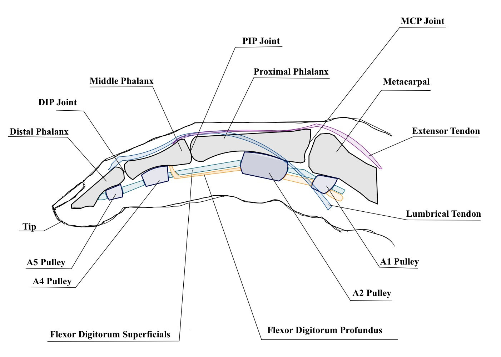
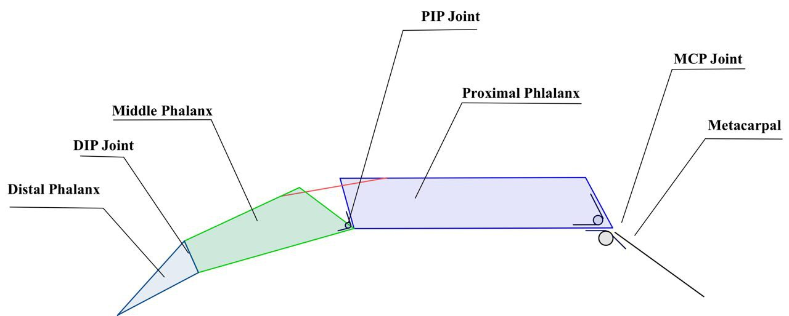
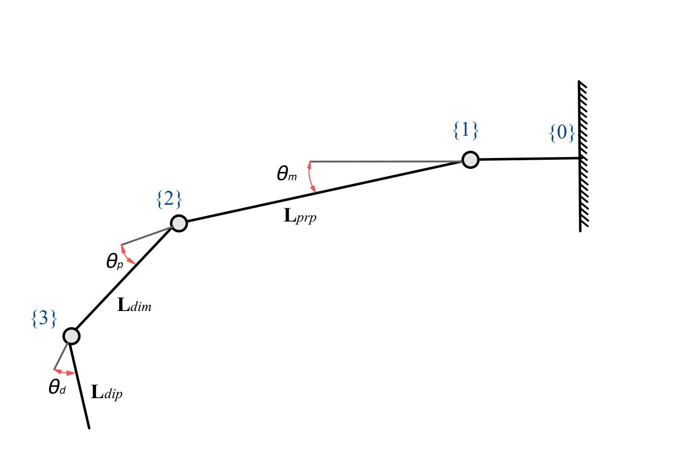
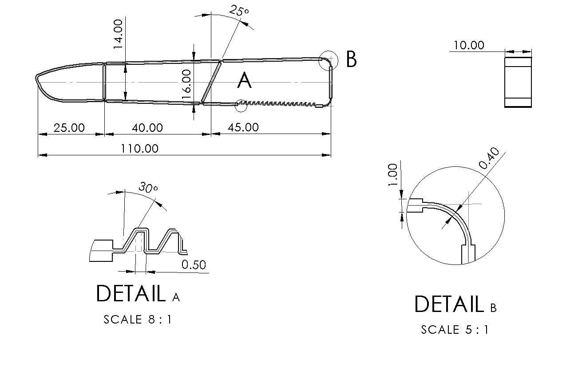
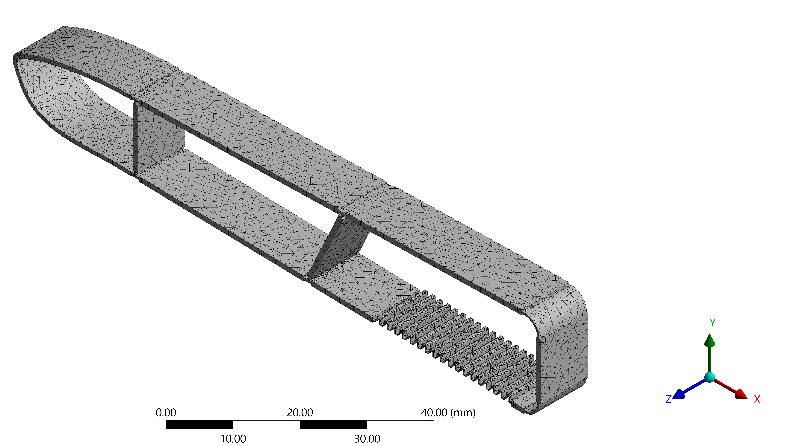
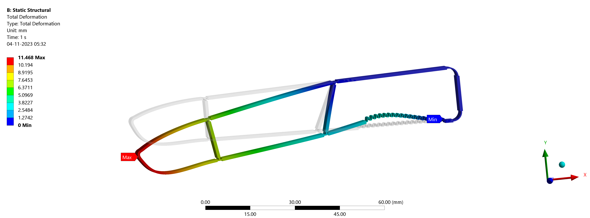
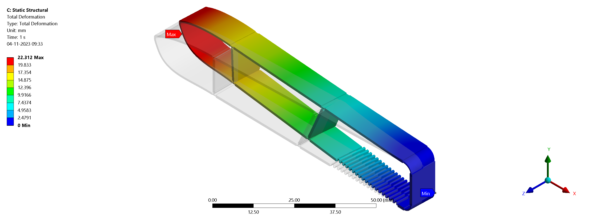

# Design and Analysis of a Compliant Prosthetic Digit

B.Tech Mechanical Engineering capstone project focused on the **design and structural analysis of a compliant prosthetic finger** intended for additive manufacturing.

The project investigates replacing conventional mechanical finger joints with **flexure joints**, reducing the number of individual components and potential points of failure.

---

## Project Overview

- Designed a compliant prosthetic digit based on human finger kinematics.
- Developed the CAD model in **SolidWorks**.
- Designed the prototype for **FDM additive manufacturing using ABS**.
- Modelled the finger using compliant flexure joints.
- Studied the kinematics of the MCP, PIP and DIP joints.
- Performed structural simulations using **ANSYS**.
- Evaluated the design under axial and lateral loading.
- Considered the anisotropic material behaviour introduced by FDM manufacturing.

---

## Human Finger Anatomy

The mechanical model was developed by studying the anatomy and joint arrangement of the human finger.

  

---

## Kinematic Model

The finger was represented as a series of links corresponding to the proximal, middle and distal phalanges.

  

The linkage was then simplified into a kinematic representation for analysing the motion of the finger.

  

### Kinematic Transformation

The transformation between the individual links was formulated as:

$$
[T_4^0] =
\begin{bmatrix}
C_{(\theta_m+\theta_p+\theta_d)}
&
-S_{(\theta_m+\theta_p+\theta_d)}
&
L_{prp} + L_{dip}C_{(\theta_m+\theta_p)} + L_{dim}C_{\theta_m}
\\
S_{(\theta_m+\theta_p+\theta_d)}
&
C_{(\theta_m+\theta_p+\theta_d)}
&
L_{dip}S_{(\theta_m+\theta_p)} + L_{dim}S_{\theta_m}
\\
0 & 0 & 1
\end{bmatrix}
$$

where \(C_\theta = \cos(\theta)\) and \(S_\theta = \sin(\theta)\).

---

## Material Model

The prototype was designed for fabrication using **FDM-printed ABS**.

Since FDM components exhibit direction-dependent mechanical properties, the material was modelled as anisotropic.

### Anisotropic Material Model

$$
\begin{bmatrix}
\epsilon_{xx} \\
\epsilon_{yy} \\
\epsilon_{zz} \\
\gamma_{xy} \\
\gamma_{yz} \\
\gamma_{zx}
\end{bmatrix}
=
\begin{bmatrix}
\frac{1}{E_x} &
-\frac{\nu_{xy}}{E_y} &
-\frac{\nu_{zx}}{E_z} &
0 & 0 & 0
\\
-\frac{\nu_{xy}}{E_x} &
\frac{1}{E_y} &
-\frac{\nu_{zy}}{E_z} &
0 & 0 & 0
\\
-\frac{\nu_{xz}}{E_x} &
-\frac{\nu_{yz}}{E_y} &
\frac{1}{E_z} &
0 & 0 & 0
\\
0 & 0 & 0 &
\frac{1}{2G_{yz}} &
0 & 0
\\
0 & 0 & 0 &
0 &
\frac{1}{2G_{xz}} &
0
\\
0 & 0 & 0 &
0 & 0 &
\frac{1}{2G_{xy}}
\end{bmatrix}
\begin{bmatrix}
\sigma_{xx} \\
\sigma_{yy} \\
\sigma_{zz} \\
\tau_{xy} \\
\tau_{yz} \\
\tau_{zx}
\end{bmatrix}
$$

---

## Compliant Finger Geometry

Conventional revolute joints were replaced with compliant flexure sections to create a finger that could be manufactured as a largely continuous component.

  

---

## Finite Element Model

The compliant finger was meshed and analysed using **ANSYS**.

  

Two primary loading conditions were investigated.

### Axial Loading

  

### Lateral Loading

  

The analysis indicated that the design performs better under **axial loading**, while lateral loading presents greater limitations due to the shear behaviour of the printed structure.

---

## Tools & Methods

- SolidWorks
- ANSYS
- Finite Element Analysis
- FDM Additive Manufacturing
- Mechanical Design
- Compliant Mechanisms
- Finger Kinematics
- Anisotropic Material Modelling

---

## Project Report

The complete B.Tech capstone report containing the methodology, theoretical development, simulations and results is available here:

### [View Full Capstone Project Report](report/Capstone_Report.pdf)